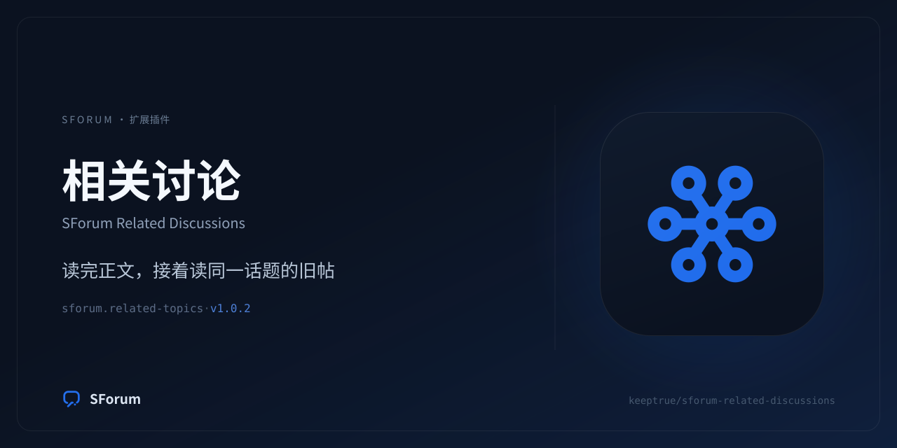

# SForum Related Discussions



帖子页正文下方的相关讨论：把被埋没的旧帖重新带回流量。

- ID: `sforum.related-topics`
- Type: `plugin`
- Manifest contract: `sforum.manifest@3`
- Host protocol: `sforum.host@2`（Protocol V2，需要 SForum `>=0.1.0`）
- Website: https://github.com/keeptrue/sforum-related-discussions

## 这个包做什么

在 `forum.topic.show` 的 `comments_after` 区域挂一个 `l2Widget`：按 `pg_trgm` 标题
相似度 + 同分类加权 + 时间半衰，列出与当前帖子相关的其他帖子。相关性判定只读标题
与分类，不读正文、不调模型。

## 包内文件

```text
sforum.extension.json          清单（Manifest V3）
brand/                         图标与社交卡（不进 packageFiles，随包树摘要变化）
frontend/related.mjs           帖子页正文下方的 L2 列表组件
openapi/routes.yaml            GET /related
schemas/                       路由响应、hook 输入、job payload、组件 props
backend/                       Protocol V2 后端（hashicorp-go-plugin）
```

## 契约要点

- 事件 `topic.created` / `topic.updated` / `topic.deleted` 走 `observe` +
  `fail_open`：索引写失败不会挡住发帖，漏掉的由每日 `reconcile` 兜底。
- 数据库申请 `own_schema`（`sforum_related_discussions`）与 `core_views`
  （只读 `sforum_core_v1.forum_topics`）。宿主只登记 `migrations[]` 不执行 SQL，
  所以建表在插件首次连库时自己做，本包因此不声明 `migrations[]`。
- 设置项四个：启用、显示条数、最低相似度、同分类优先；改动立即生效。

完整设计取舍见仓库根 `README.md` 与 `NOTES.md`。
